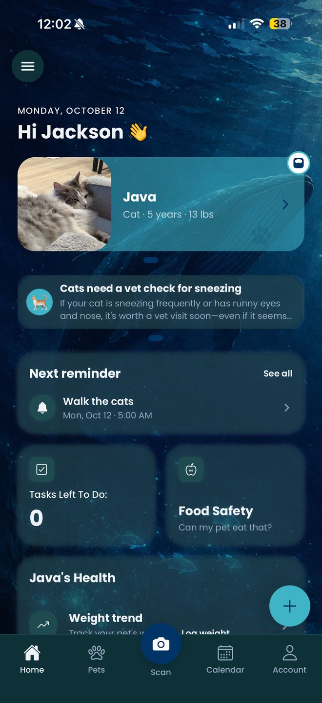

# Rava case study: shipping an app without writing the code

A longer, optional read. The short version is in the [README](README.md).

Throughout: I made the decisions and did the testing; Claude (Anthropic's AI) wrote the code under my direction. Dates are 2026.

## Timeline

**Phase 1: Prototype to iPhone app (spring)**

I already had a web prototype of the product. I froze it and made it the spec: the iPhone app would be a faithful, screen-by-screen translation. A single tracking document listed every screen, its source in the prototype, and its status. This phase covered sign-in, onboarding, pet profiles, the symptom check, calendar and reminders, and the account area.

**Phase 2: The bigger features (late May)**

Household sharing (inviting family and helpers, with different permissions), vet-visit prep, the subscription and paywall, and a theme system with illustrated backgrounds. I made the product calls, such as the roles, the limits, and what is free versus paid, and the AI built to them. Two full AI code reviews were run in this period, each followed by a fix pass.

**Phase 3: Rename and launch push (by early October)**

The original product name turned out to have a trademark conflict, so I renamed the product to Rava. Then one long push took it to a real build installed on my phone through TestFlight, with sign-in, subscriptions, the privacy policy, the domain and the store listing all set up.

**Phase 4: Testing and hardening (mid October)**

Two rounds of testing on my phone produced a list of real bugs, all fixed. I had the AI run a security audit of the whole project and fix what it found. I added an in-app list of independent reading and "further reading" links on results.

**Phase 5: App Review (mid October to November)**

First submission, an information request, a decision to go iPhone-only, a photo bug found and fixed mid-review, a long wait, two rejections, and resubmission. As of November the app is in review.

## Decisions and trade-offs

- **iPhone-only at launch.** The first build claimed iPad support, so Apple required iPad screenshots. I chose to launch on iPhone only. Cost: a rebuild and no iPad users on day one.
- **Verified email sign-up instead of Apple and Google only.** Simpler sign-in was the original plan. I changed it because email is what many people expect, but only with a verification code, which meant setting up email sending from my own domain first.
- **Reading links, not AI-quoted research.** I looked at whether published veterinary research could supply the app's content. The verdict was no: it is written for professionals and much of it is copyrighted. So the links sit beside a result as optional reading and do not change the guidance. The AI recommended this cautious version and I agreed.
- **Hard account deletion for version 1.** Deleting an account removes the data permanently. A recoverable grace period is a known upgrade for after launch.
- **Free core, paid extras.** The symptom check and record-keeping are free. The subscription covers sharing, vet-visit prep, the Pet Health Card and extra themes.
- **Scope freeze.** Ideas that came up mid-build went to a parking list instead of into version 1.
- **Deferred on purpose.** Android, and expert review of the guidance for less common species, are after launch.

## What went wrong

- **The AI silently damaged files.** During one large fix pass, an AI session cut off the ends of many files without saying so. It was caught because the automated code check suddenly reported hundreds of errors. Every affected file was restored from the last saved version and the work was redone in smaller steps from a written handoff note. It is one reason I back up after every session.
- **The app froze after logging a pet's weight.** I had to force-quit it on my phone. The cause was two pop-up panels trying to open and close at the same moment. This never showed up until I used the real build the way a user would.
- **Unreadable text in dark mode.** Covered in the README. Found only by looking at the phone.
- **A build failed because of a missing ingredient.** The photo fix needed a new component that had not been properly added to the project, so the next build failed. One command fixed it, but it cost a build cycle.
- **A paywall promise that didn't exist yet.** The paywall advertised a discounted first month before that offer had been created in the store. It was caught and created before submission. It would otherwise have been both a rejection and a truthfulness problem.
- **Review stalled for a reason that had nothing to do with the app.** Updated developer agreements were waiting for my acceptance. We found it by checking the account.
- **I deleted my own demo account.** While recording the account-deletion flow for Apple, I deleted the account Apple's reviewer was meant to use. I re-created it, and now use throwaway accounts for recordings.

## What I learned about working with AI

1. **Write things down or lose them.** The AI does not remember yesterday. The instruction file and the status log are the project's memory, and keeping them accurate is my job.
2. **A fixed reference beats a description.** "Match the prototype" removed hundreds of small design debates.
3. **"Done" means I used it on my phone.** Code that passes its checks can still freeze, be unreadable, or fail with a real photo.
4. **Report bugs precisely.** "Checks with a photo fail, checks without one work" got a correct diagnosis quickly. "It's broken" would not have.
5. **Keep changes small.** The one time a session tried to change everything at once, it broke the project.
6. **Ask for the trade-off, then decide.** I ask the AI for plain-language options and an honest recommendation, including pushback. The decision stays with me.
7. **Keep a human on the irreversible steps.** Submitting, deleting, and entering credentials are mine. The AI stops and asks.
8. **Have the AI check the AI.** Separate review and audit passes found problems the building sessions missed.
9. **Be more careful than you think you need to be with claims.** In health, every sentence is a claim. Informational, not a diagnosis, and no borrowed credibility.
