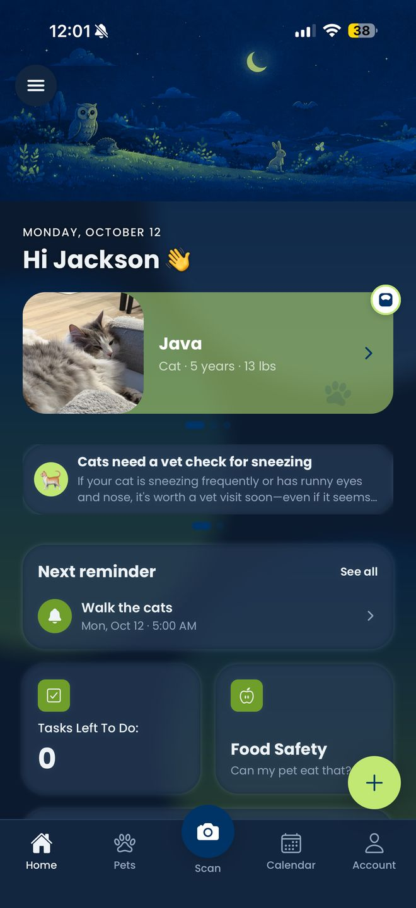
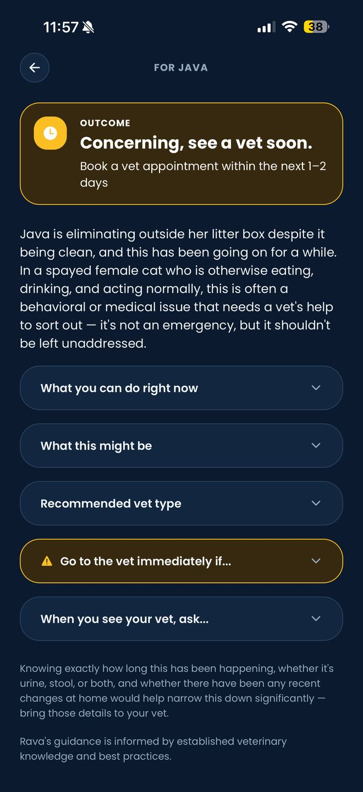
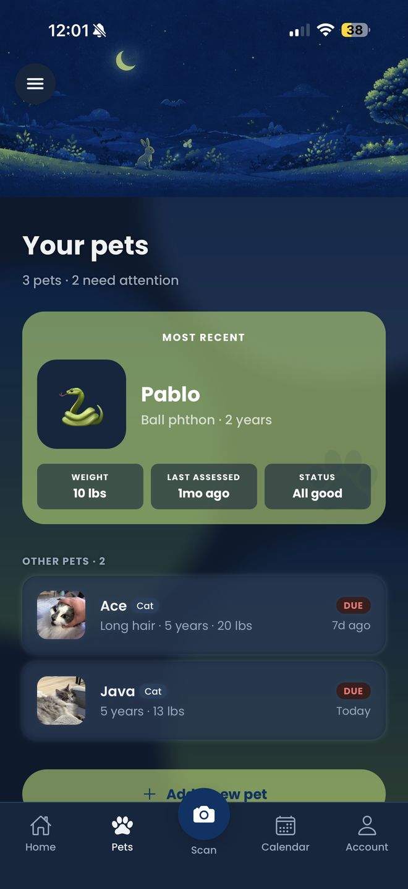
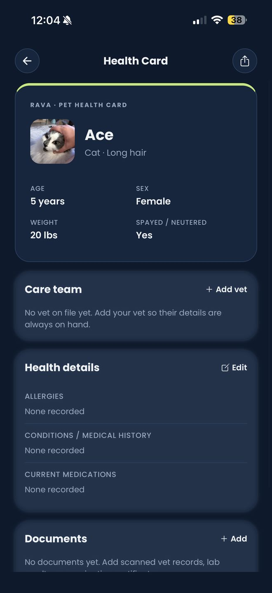
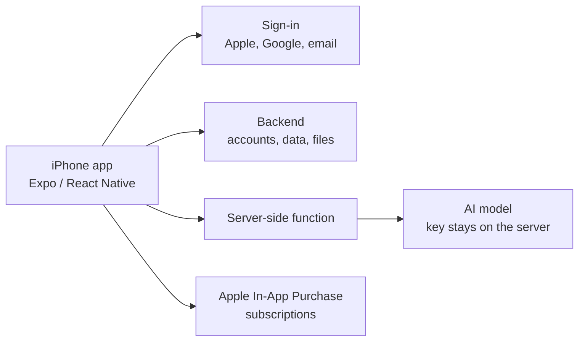

# Rava: a pet-health iPhone app I built by directing AI

I'm Jackson Davis. I'm not a programmer. I designed, specified, tested and submitted a complete iPhone app by directing an AI (Claude) that wrote the code. This repository shows what I built and how I worked. The app's source code is private, so this is a showcase and not the codebase.

## What Rava is

Rava helps pet owners decide what to do when something seems wrong with their pet. You describe the symptoms (and can add a photo), answer a few species-specific questions, and get one of three plain-language outcomes: emergency, see a vet soon, or monitor at home, along with what to do right now and the signs that mean it's time to go in. It also keeps each pet's profile, health records, reminders and calendar in one place, for everything from dogs and cats to reptiles and farm animals.

Rava is an informational tool, not a veterinary service. Its guidance is not a diagnosis.

  
  
  
  

## Status

- Built solo.
- In App Store review as of November 2026. It is not yet available to download.
- Website: [ravapets.com](https://ravapets.com)
- Free to use, with an optional subscription (Rava Plus: $7.99/month or $49.99/year) billed through Apple.

## My role and the AI's role

I want to be exact about this, because it is the point of the repository.

**What I did**

- Decided what to build and what to leave out, and wrote the requirements.
- Made the product, design and business decisions: features, free vs paid, pricing, wording, which devices to support, when to ship.
- Tested builds on my own iPhone, found the bugs, and reported them with enough detail to be fixed.
- Ran the release process: developer accounts, App Store listing, subscriptions setup, App Review submissions and replies, domain, email and other vendors.
- Approved or refused every irreversible step.

**What the AI did**

- Claude (Anthropic's AI, used through Claude Code and Cowork) wrote the code, under my direction. I did not hand-write the app's code.
- It also diagnosed bugs I reported, drafted documents and App Review replies for me to approve, and operated some web dashboards while I watched.

The skill I'm showing is directing AI to ship a real, complete product: knowing what to ask for, checking what comes back, and owning the decisions.

## How I work with AI

These are the practices I actually used, not a theory.

- **A project instruction file.** One document the AI reads at the start of every session: what the product is, the conventions to follow, the decisions already made, and what must never be changed.
- **A running status log.** At the end of each session the AI updates a log of what was done, what is in progress, what is blocked and what is next. The next session starts from that, so nothing gets re-argued or redone.
- **A frozen prototype as the spec.** An earlier web prototype of the app is the design source of truth. It is never edited. Every screen in the iPhone app is a translation of a prototype screen, and any deliberate difference is noted where it happens.
- **Scope freeze for version 1.** Version 1 ships finished flows, not more features. "Small fixes" are not allowed to grow the scope.
- **An AI security audit, then a fix pass.** Before submission I had the AI audit the whole project for security problems, then fix what it found. I don't publish the findings.
- **Verify on a real device.** The AI saying "done" is not the test. I install each build on my phone and use it. Several of the bugs below were only visible that way.
- **Human approval before anything irreversible.** Submissions, deletions and anything involving credentials wait for my explicit go-ahead. I enter passwords myself; the AI does not.

## Under the hood (high level)

- iPhone app built with Expo and React Native.
- Supabase backend for accounts, data and file storage.
- The AI request runs on the server, so the AI key never ships inside the app.
- Subscriptions through Apple In-App Purchase.
- Sign-in with Apple, Google, or email (verified with a code).

Three small, safe code samples are in [`samples/`](samples/). They are there to show the kind of code the AI wrote for me, not to represent the whole app.

## Problems I ran into and what I did

**1. App Review said no, more than once**

- Problem: Apple asked for more information and a screen recording; then demanded iPad screenshots; then the review sat for about 11 days; then two rejections (the app asked for a name after Sign in with Apple, the subscriptions had not been submitted alongside the app, and later the listing lacked a Terms of Use link).
- What I did: Treated each one as a specific fix. Sent the information and recording. Decided to launch iPhone-only and rebuilt. Found that updated developer agreements were waiting for my acceptance and accepted them. Had the name step removed for Apple sign-ins, submitted the subscriptions together with the app, and added the Terms of Use and Privacy Policy links to the paywall and the listing.
- Result: Each issue was answered and the app was resubmitted. It is in review now.

**2. Symptom checks with a photo always failed**

- Problem: After a build was already submitted, I found that any check with a photo showed an error, while checks without one worked.
- What I did: Reported exactly what worked and what didn't. The AI traced it to photo size: modern phone photos were too large to send, and some were in a format the AI model doesn't accept. The fix shrinks and converts each photo first (see [`samples/prepare-photo.ts`](samples/prepare-photo.ts)).
- Result: I replaced the submitted build with the fixed one and confirmed on my phone that photo checks work.

**3. Text I couldn't read in dark themes**

- Problem: Testing on my phone, the result banner was unreadable in dark mode, and two photo buttons were invisible on the night themes.
- What I did: Sent the reports from the device. The cause was colours being fixed once at start-up instead of following the active theme.
- Result: Fixed so text and buttons follow the theme in both light and dark. I now check every new screen in both.

**4. Adding email sign-up properly**

- Problem: I first planned Apple and Google sign-in only. I then decided to offer email sign-up at launch, but an unverified email sign-up is a weak point.
- What I did: Required a 6-digit code sent to the address before an account is usable, made password reset code-based too, and set up email sending from the product's own domain. Later added a check that catches common typos in an email address (see [`samples/email-typo.ts`](samples/email-typo.ts)).
- Result: Verified email sign-up shipped in the build that is under review. The typo check is written and scheduled for the first update.

**5. Keeping health guidance honest**

- Problem: A health app invites over-claiming: sounding like a diagnosis, implying outside organisations back it, or promising more than the paywall delivers.
- What I did: Kept every result framed as possibilities with clear "see a vet" triggers and a plain not-a-diagnosis note. Added links to independent, publicly available reading with an explicit statement that Rava is not affiliated with those sources. Corrected subscription wording so it states the auto-renewal terms accurately, and made sure the advertised first-month offer really existed before submitting.
- Result: The app, the store listing and the website all say the same careful thing.

More detail, including what went wrong along the way, is in [CASE-STUDY.md](CASE-STUDY.md).

## What I'd do next

- Get through review and launch, then fix what real users hit first.
- Have a veterinarian review the guidance for exotic pets and farm animals, where it is deliberately more general today.
- An Android version.
- Smaller upgrades I've already scoped, such as putting the Pet Health Card in Apple Wallet.

## Contact

[ravapets.com](https://ravapets.com)

---

This repository is for portfolio review only. All rights reserved; see [LICENSE](LICENSE).
